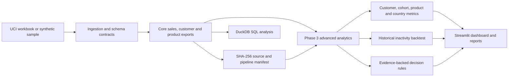

# RetailPulse — E-commerce Business Intelligence

[](https://github.com/archivesofkrish/retailpulse-ecommerce-analytics/actions/workflows/tests.yml)
[](https://github.com/archivesofkrish/retailpulse-ecommerce-analytics/actions/workflows/codeql.yml)
[](https://github.com/archivesofkrish/retailpulse-ecommerce-analytics/actions/workflows/dependency-audit.yml)
[](https://www.python.org/)
[](LICENSE)

**RetailPulse is a reproducible, end-to-end business intelligence project** built around the UCI Online Retail II transaction dataset. It combines Python data engineering, SQL analytics, customer segmentation, cohort activity, merchandise and market analysis, a historical inactivity-model backtest, and a nine-section Streamlit dashboard.

**Current release:** `1.4.0` — adds the Customer Value Studio, observed cohort revenue-yield analysis, a cohort heatmap, and a refreshed nine-section dashboard alongside the Repeat-Purchase Scenario Lab.

> **Historical-data notice:** The source workbook covers **1 December 2009–9 December 2011**. RetailPulse is an analytical case study, not a live retailer feed. Its reported revenue is not profit, historical customer spend and cohort revenue yield are not projected customer lifetime value, and the inactivity model is not a production churn score.

## Project at a glance

| Capability | Implementation |
|---|---|
| Data pipeline | Python, pandas, NumPy |
| Query layer | SQL, DuckDB |
| Customer analytics | RFM, customer concentration, repeat purchase, cohorts |
| Product and market analytics | Merchandise classification, SKU Pareto, country concentration, basket associations (support/confidence/lift) |
| Decision intelligence | Transparent business insight rules, threshold evidence, recommended actions and guardrails |
| Commercial scenario planning | Interactive repeat-purchase scenarios, sensitivity analysis and assumption-driven gross-revenue calculations |
| Historical model | Random Forest, chronological holdout, 90-day embargo |
| Dashboard | Streamlit, Plotly (nine sections) |
| Quality | schema and finite-value contracts, pytest, reconciliation validator, temporal and cohort regression tests |
| Deliverables | Executive report, 11-slide presentation, portfolio guide |

## How the system works



## Engineering highlights

- **Data contracts:** explicit source-column aliases, finite numeric validation, transaction classification and revenue reconciliation.
- **Identity correctness:** customer IDs remain opaque strings; zero-padded and alphanumeric IDs stay distinct through advanced analytics.
- **Correct analytical grain:** SKU quantity and revenue diagnostics are aggregated at invoice + stock-code level before per-invoice maxima are calculated.
- **Reproducibility:** SHA-256 fingerprints, pipeline run IDs, atomic manifests and freshness checks prevent advanced outputs from silently drifting from their source.
- **Honest empty states:** sales-level reporting still completes when customer IDs or merchandise SKUs are unavailable; unsupported customer/product metrics are marked unavailable rather than fabricated.
- **Model governance:** the inactivity backtest uses chronological snapshots and a 90-day embargo, with limitations documented in the dashboard and report.
- **Software quality:** Python 3.11–3.14 CI, end-to-end pytest coverage, CodeQL, dependency vulnerability auditing, Dependabot and Docker health checks.

## Key findings from the historical dataset

These values describe the supplied 2009–2011 source period and are reproduced in the executive report.

| Measure | Result |
|---|---:|
| Original source rows | 1,067,371 |
| Gross sales-line revenue | £20,972,594.57 |
| Distinct sales invoices | 40,077 |
| Identified customers | 5,878 |
| Identified-customer revenue share | 84.6% |
| Revenue on sales lines without a customer ID | 15.4% |
| Merchandise revenue | £20,112,163.17 |
| United Kingdom share of gross sales-line revenue | 85.21% |
| Identified customers with 2+ purchases | 72.39% |
| Customer revenue Gini | 0.742 |

The dataset has five malformed rows excluded during core validation. The remaining 1,067,366 rows reconcile to 1,041,670 sales lines, 22,951 return/cancellation lines, and 2,745 other valid rows. Return/cancellation value is reported separately, not treated as a definitive accounting refund or net-sales adjustment.

## Dashboard

The Professional Edition dashboard has nine sections:

1. **Overview** — filter-aware sales KPIs, revenue trend, country sales, merchandise rankings and weekday activity.
2. **Customer Intelligence** — historical customer spend, Pareto concentration, Gini and RFM segment economics.
3. **Customer Value Studio** — monthly cohort revenue yield, cumulative observed revenue per acquired customer, retention curves, a value heatmap and 12-period mature-cohort comparisons.
4. **Retention** — repeat-purchase windows and right-censored cohort activity.
5. **Products & Markets** — merchandise-only rankings, SKU concentration, country concentration, product affinity and unusual one-invoice product records.
6. **Decision Brief** — transparent business insights, evidence thresholds, suggested experiments and interpretation guardrails.
7. **Scenario Lab** — conservative, base and stretch repeat-purchase scenarios, configurable conversion uplift and average-order-value assumptions, and a gross-revenue sensitivity curve.
8. **Inactivity Model** — historical 90-day inactivity backtest, monthly holdout AUC, feature importance and interpretation limits.
9. **Data Quality** — row classification, revenue reconciliation, definitions and reproducibility instructions.

Overview charts respond to the sidebar filters. The advanced Phase 3 panels use the full source period and are labelled accordingly; they do not silently change with the overview filters.

## Dataset and attribution

**Dataset:** [UCI Online Retail II](https://archive.ics.uci.edu/dataset/502/online%2Bretail%2Bii)\
**Creator:** Daqing Chen\
**Coverage:** 1 December 2009–9 December 2011\
**Rows:** 1,067,371 invoice-line records\
**Licence:** Creative Commons Attribution 4.0 International (CC BY 4.0)\
**Citation:** Chen, D. (2012). *Online Retail II* [Dataset]. UCI Machine Learning Repository. [https://doi.org/10.24432/C5CG6D](https://doi.org/10.24432/C5CG6D)

The original workbook is **not included** in this repository. Use `scripts/download_data.py` to retrieve it into `data/raw/`. The downloader records a timestamp, file size and SHA-256 digest in `data/raw/manifest.json`. Raw and processed transaction data are excluded from Git by `.gitignore`.

The repository includes a small **synthetic demonstration sample** for smoke tests and offline exploration. Synthetic results must never be presented as UCI retailer findings.

## Quick start

Requires Python 3.11 or newer. The full nine-section Professional Edition uses the full UCI workbook.

### Linux / macOS

```bash
# From the repository root
python3.11 -m venv .venv
source .venv/bin/activate
python -m pip install --upgrade pip
pip install -r requirements.txt

# Download the full historical UCI workbook
python scripts/download_data.py

# Build core analytical exports and reports
python scripts/run_analysis.py

# Validate the original workbook and reconcile key invariants
python scripts/validate_real_data.py

# Generate advanced customer, cohort, product, country and model outputs
python scripts/run_phase3_analysis.py

# Verify core and Phase 3 output checksums and lineage
python scripts/verify_outputs.py

# Run all tests with deprecation warnings treated as errors
python -W error::DeprecationWarning -m pytest -q

# Launch the dashboard
streamlit run dashboard/app.py
```

Open the local URL printed by Streamlit (normally `http://localhost:8501`). Keep the terminal process running while using the dashboard. Stop it with `Ctrl+C`.

### Container deployment

RetailPulse includes a non-root Docker image, a read-only Compose deployment for the source and generated analytical data, and a CI container health check. Run the data pipeline on the host first, then start the dashboard container:

```bash
mkdir -p data/raw data/processed reports/phase3
python scripts/download_data.py
python scripts/run_analysis.py
python scripts/run_phase3_analysis.py
docker compose up --build -d
```

Open `http://localhost:8501`. The container mounts the raw workbook and generated analytical outputs read-only; source data is not copied into the image. For complete setup, update and security guidance, see [Container deployment](docs/DEPLOYMENT.md).

### Windows PowerShell

```powershell
py -3.11 -m venv .venv
.\.venv\Scripts\Activate.ps1
python -m pip install --upgrade pip
pip install -r requirements.txt
python scripts/download_data.py
python scripts/run_analysis.py
python scripts/validate_real_data.py
python scripts/run_phase3_analysis.py
python -W error::DeprecationWarning -m pytest -q
streamlit run dashboard/app.py
```

### Offline / synthetic demonstration mode

Skip the download step and run:

```bash
python scripts/run_analysis.py
streamlit run dashboard/app.py
```

The pipeline selects `data/sample/sample_retail_transactions.csv` when the UCI workbook is absent. The dashboard clearly identifies this as **DEMO MODE**. The sample is for pipeline and interface smoke testing; it is not large or representative enough for the full customer-segmentation and inactivity-model conclusions in the executive report. Download the UCI workbook to reproduce the complete case study.

## SQL analysis

After `python scripts/run_analysis.py`, execute the DuckDB query examples:

```bash
python scripts/run_sql.py
```

The source queries are in `sql/analysis.sql` and use the CSV outputs under `data/processed/`.

## Reproduce the project

The main pipeline writes core exports and a `pipeline_manifest.json` to `data/processed/`. The manifest records a run ID, source-file SHA-256 fingerprint, source file signature, reporting period, row counts, and SHA-256/size fingerprints for every generated CSV and KPI JSON export. The Phase 3 runner verifies the core exports before reading them, then writes advanced tables, figures, `phase3_summary.json` and a matching `phase3_manifest.json` with fingerprints for every generated Phase 3 artifact. The dashboard verifies source lineage and both output manifests before enabling advanced panels; edited, missing or incomplete exports are rejected rather than silently displayed. Run `python scripts/verify_outputs.py` to print a machine-readable integrity report and return a non-zero exit code when any artifact or lineage check fails. Re-run the core pipeline and then Phase 3 after replacing the source workbook. The SQL runner refuses incomplete core exports. The real-data validator writes `test-results/real_data_validation.json`.

Generated raw workbooks, processed transaction exports, per-customer outputs and machine-specific validation JSON are ignored by Git. They can be regenerated with the commands above. Aggregated executive reports, methodological notes, static charts and the presentation are included as portfolio artefacts.

## Repository structure

```text
RetailPulse/
├── .github/workflows/        # Continuous integration
├── dashboard/app.py          # Nine-section Streamlit dashboard
├── data/
│   ├── raw/                  # Downloaded UCI workbook (git-ignored)
│   ├── sample/               # Synthetic smoke-test data
│   └── processed/            # Generated analytical exports (git-ignored)
├── docs/                     # Architecture, methods, limitations, insights and deployment guides
├── notebooks/                # Guided exploratory walkthrough
├── presentations/            # 11-slide executive review
├── reports/
│   ├── RETAILPULSE_EXECUTIVE_REPORT.md
│   └── phase3/                # Aggregate report and static analytical figures
├── scripts/                  # Download, core analysis, validation and Phase 3 runner
├── sql/analysis.sql          # DuckDB examples
├── src/retailpulse/          # Reusable analysis, decision-intelligence and scenario functions
├── tests/                    # Core, cohort and temporal split tests
├── test-results/             # Curated validation evidence
├── DATA_LICENSE.md
├── LICENSE
├── pyproject.toml
└── requirements.txt
```

## Methodology and interpretation

### Transaction classification

- Standardise source headers and parse date and numeric fields.
- Drop rows missing core fields and reject non-positive unit prices from the sales definition.
- Retain valid anonymous transactions for sales-level totals, while excluding them from identified-customer analysis.
- Treat `C`-prefixed invoices and negative-quantity lines as return/cancellation records.
- Classify remaining valid non-sales/non-return lines separately so row counts reconcile.
- Define gross sales-line revenue as `quantity × unit_price` for included sales lines.
- Report recorded return/cancellation value separately; do not silently subtract it as an accounting net-sales measure.

### Customer and retention metrics

- RFM uses relative within-dataset quintile scoring and rule-based segment labels. These labels are heuristics, not observed ground-truth categories.
- Historical customer revenue is observed spend over the source window, not predicted CLV.
- Repeat purchase means a second distinct invoice for an identified customer.
- Follow-up rates use only first-time customers with a complete observation window for the selected horizon.
- Cohort heatmaps show point-in-time monthly activity, not cumulative survival. Unobserved future months are blank (right-censored); observed months with no cohort purchases are zero.

### Product and market metrics

Operational/non-merchandise stock codes remain in gross sales-line revenue but are excluded from merchandise rankings. Stock code 23843 (`PAPER CRAFT , LITTLE BIRDIE`) records 80,995 units on one invoice for £168,469.60; the record is retained and flagged for source-document review. Revenue is not profit or margin. Country concentration is descriptive, not a market-entry recommendation by itself.

### Historical inactivity backtest

The Random Forest target is no identified-customer invoice during the 90 days after a historical monthly snapshot. Features are built from information available on or before each snapshot. Training snapshots end 31 October 2010; a 90-day label horizon and embargo precede held-out snapshots from 31 January through 31 August 2011.

The held-out ROC-AUC is 0.791 and average precision is 0.843. Training and test inactivity prevalence differ (48.1% vs 64.1%). Customer-month observations repeat the same customers and are not independent; test 90-day windows can overlap. Model scores are not calibrated for financial forecasts or current customer risk. This is a retrospective ranking proof of concept, not a deployable churn model.

## Commercial scenario planning

The dashboard's Scenario Lab uses the historical 90-day eligible first-time-customer base, observed second-purchase rate and average order value across identified-customer invoices. It lets a user define conservative, base and stretch conversion improvements, adjust the historical order-value assumption, and inspect the resulting expected additional second orders and gross revenue. The calculations are transparent and deterministic. They are scenario arithmetic—not predictive modelling, causal lift, profit forecasts or current-customer estimates. See [Scenario Lab methodology](docs/SCENARIO_LAB.md). The Customer Value Studio complements this with descriptive cohort economics: it measures observed gross revenue per originally acquired customer and customer activity over time, without projecting future lifetime value. See [Customer Value Studio methodology](docs/CUSTOMER_VALUE_STUDIO.md).

## Business decision intelligence

The Phase 3 pipeline evaluates explicit, documented thresholds for customer-ID coverage, geographic concentration, customer revenue concentration, 90-day second-purchase conversion, merchandise basket associations and merchandise assortment concentration. Triggered findings are written to `reports/phase3/business_insights.csv`, included in `phase3_summary.json`, and displayed in the dashboard's Decision Brief. Each result includes its observed evidence, trigger threshold, recommended next action and limitation. The rules generate investigation prompts; they do not make autonomous commercial decisions or claim causal effects. See [Business Insights](docs/BUSINESS_INSIGHTS.md) for rule definitions.

## Validation

The release test suite includes input-schema ambiguity checks, blank-identifier checks, finite numeric and line-value checks, customer-ID normalisation, transaction, RFM, row-reconciliation, merchandise-classification, right-censoring and temporal-embargo regression tests, plus a synthetic-data integration smoke test that executes the core pipeline through Phase 3 and validates the lineage manifests. See [Data Contracts](docs/DATA_CONTRACTS.md) for accepted input fields and rejection rules. The CI workflow tests Python 3.11, 3.12, 3.13 and 3.14, installs the package in editable mode, builds distribution artefacts on Python 3.14, checks dependency consistency, and publishes downloadable JUnit test reports. CodeQL analyses Python code; pip-audit checks the resolved dependency graph; Dependabot proposes Python, GitHub Actions and Docker base-image updates. The full UCI workbook validator checks eight data-quality and reconciliation conditions.

```bash
python -W error::DeprecationWarning -m pytest -q
python scripts/validate_real_data.py
```

See `test-results/RELEASE_VALIDATION.md` for the validation scope and what was run in the build environment versus on the project owner's machine.

## Security and supported runtime

RetailPulse requires Python 3.11 or newer. Python 3.10 reached upstream end-of-life on 1 October 2026. CI tests Python 3.11–3.14, and the dashboard container runs Python 3.12. See [Security posture](docs/SECURITY_POSTURE.md) and [Security Policy](SECURITY.md).

The repository includes CodeQL code scanning, Dependabot update proposals, multi-version tests, downloadable JUnit results and a non-root Docker runtime. These controls do not replace review of dependency alerts or repository settings. In particular, the main branch still needs administrator-configured branch protection and private vulnerability reporting.

## Portfolio deliverables

- [`reports/RETAILPULSE_EXECUTIVE_REPORT.md`](reports/RETAILPULSE_EXECUTIVE_REPORT.md) — consolidated executive findings and recommended actions.
- [`reports/phase3/PHASE3_ADVANCED_ANALYTICS.md`](reports/phase3/PHASE3_ADVANCED_ANALYTICS.md) — detailed Phase 3 tables and model caveats.
- [`presentations/RetailPulse_Executive_Review.pptx`](presentations/RetailPulse_Executive_Review.pptx) — 11-slide executive presentation.
- [`docs/FINAL_METHODOLOGY_AND_LIMITATIONS.md`](docs/FINAL_METHODOLOGY_AND_LIMITATIONS.md) — metric definitions, validation scope and responsible-use boundaries.
- [`docs/PORTFOLIO_SHOWCASE_GUIDE.md`](docs/PORTFOLIO_SHOWCASE_GUIDE.md) — concise walkthrough for a portfolio or interview.
- [`docs/SECURITY_POSTURE.md`](docs/SECURITY_POSTURE.md) — automated controls and repository settings to enable.
- [`SECURITY.md`](SECURITY.md) — vulnerability reporting and data-safety policy.

## Licences

Project code and documentation are provided under the MIT License. The UCI dataset is separately licensed under CC BY 4.0 and must be attributed to its creator. See [`DATA_LICENSE.md`](DATA_LICENSE.md).
